<p align="center">
  
</p>

<h1 align="center">HeadsUp</h1>

<p align="center">
  <b>One shortcut for quick AI prompts, focus timers, commands and services.</b><br>
  A native, keyboard-first HUD that lives in your Mac's menu bar.
</p>

<p align="center">
  <a href="https://github.com/brickpop/heads-up/releases/latest"></a>
  <a href="https://github.com/brickpop/heads-up/actions/workflows/ci.yml"></a>
  <a href="https://github.com/brickpop/heads-up/releases"></a>
  
  
  
  <a href="LICENSE"></a>
</p>

<p align="center">
  <code>brew install --cask brickpop/tap/headsup</code>
</p>

---

Press **⌥ Space** anywhere, even over a full-screen app, and a Spotlight-style HUD drops in. Ask
a model something, start a focus block, keep the Mac awake, bring up your dev server or open a
command in your terminal, then get back to work. No browser tab, no login, no terminal tab kept
open just in case.

> [!NOTE]
> HeadsUp is early (version 0.x). Issues and ideas are welcome.

## Contents

- [Features](#features)
- [Install](#install)
- [First launch](#first-launch)
- [Keyboard](#keyboard)
- [Requirements](#requirements)
- [Privacy](#privacy)
- [Services and your shell](#services-and-your-shell)
- [Build from source](#build-from-source)
- [Contributing](#contributing)
- [License](#license)

## Features

HeadsUp is one HUD with six tabs. An **action autocomplete** in the prompt reaches every one of
them from the keyboard: type `/` to see what you can do.

| | Tab | What it does |
|---|---|---|
| 💬 | **Chat** | A quick chat with any **OpenAI-compatible** model, in the cloud or local (Ollama, LM Studio, llama.cpp…). Text and images, formatted replies that stream in, and **local tools** (Calendar, Reminders, Clipboard) that the model may call only with your permission. Chats are gone when you start a new one, unless you **pin** them. |
| ⏱️ | **Focus** | A Pomodoro timer (25 / 40 / 50 min, or `/start 35`) with break prompts that suggest something to do away from the screen. It runs the whole loop from the keyboard, and notifications let you answer without opening the HUD. |
| ☕ | **Caffeine** | Keeps your Mac awake for a set time, extendable, like a built-in Amphetamine. |
| 🗄️ | **Services** | Starts and stops the long-running things you keep a terminal tab for: a dev server, a database, a local model. Each one gets your shell's environment, and its logs are kept, one click away. |
| ⌨️ | **Commands** | Shortcuts for the interactive commands you type again and again. Each opens in your terminal (Terminal, iTerm2, Ghostty, WezTerm, Kitty, Alacritty) in the right folder. |
| ⚙️ | **Settings** | Model endpoints, tool permissions, focus and breaks, the wake shortcut, appearance. Settings, services and commands are plain JSON files in `~/Library/Application Support/HeadsUp`, which you can edit by hand too; API tokens stay in the Keychain. |

It feels like part of macOS: SwiftUI and AppKit, the system font, vibrancy, your accent color,
light and dark mode, VoiceOver, Reduce Motion and Increase Contrast.

## Install

### Homebrew

```sh
brew install --cask brickpop/tap/headsup
```

Update with `brew upgrade --cask headsup`.

### Download

Get `HeadsUp-<version>.dmg` from the [latest release](https://github.com/brickpop/heads-up/releases/latest),
open it, and drag **HeadsUp** to Applications. Each release lists the `.dmg`'s SHA-256 next to
it.

## First launch

> [!IMPORTANT]
> HeadsUp isn't notarized by Apple yet, so macOS blocks it the first time you open it.
> Open it once, then go to **System Settings › Privacy & Security** and click **Open Anyway**.
> You only do this once per version.

Then:

1. Press **⌥ Space**. HeadsUp lives in the menu bar; it has no Dock icon.
2. To chat, add a model in **Settings › Models**: any OpenAI-compatible endpoint, with or without
   a token. For a local Ollama, the URL is `http://localhost:11434/v1`.
3. macOS asks before HeadsUp reads your Calendar or Reminders, or opens a command in your
   terminal (Automation). It asks only when you first use that feature.

> [!NOTE]
> Releases are signed ad-hoc for now, so each update is a new app to macOS: it asks again for the
> permissions you gave, and for your login password the first time HeadsUp reads a saved API
> token from the Keychain.

## Keyboard

| Keys | What they do |
|---|---|
| **⌥ Space** | Show or hide HeadsUp (you can change it in Settings › General) |
| **⌘1 … ⌘6** | Chat, Focus, Caffeine, Services, Commands, Settings |
| **/** | Actions: type to filter, **↑ ↓** to pick, **↩** to run |
| **⌘N** · **⌘P** · **⌘.** | New chat · pin the chat · stop the reply |
| **⌥← ⌥→** · **⌘↩** | On Focus: pick a length or a break · start |
| **⌘ ,** | Settings |
| **Esc** | Clear, go back, then close |

## Requirements

- macOS 14 Sonoma or later
- A Mac with Apple silicon
- For Chat: an OpenAI-compatible endpoint, local or in the cloud

## Privacy

- **No telemetry**, no account and no server of ours. HeadsUp talks only to the model endpoints
  you add.
- **Chats aren't kept** unless you pin them. Pinned chats stay on your Mac.
- **API tokens live in your Keychain**, never in `settings.json`.
- **The model touches your data only when you allow it.** Each tool is set to Allow, Ask or Off.
  With Ask, the chat shows a card and the tool waits for your answer. Every call shows in the
  chat.

## Services and your shell

<details>
<summary>How a service gets your <code>PATH</code> and environment</summary>

A service starts with the environment your terminal has. Your shell's interactive config runs
once, at the first service start after HeadsUp launches: HeadsUp runs your login shell as an
interactive login shell (`-l -i`), so it reads `.zshrc`, `.bashrc` or fish's config, and keeps
the variables it prints. Meanwhile the service shows as Starting, and its log says "Reading your
shell's environment…". Then these folders are added at the end of `PATH` when they are missing,
exist, and only you or root can write to them and every folder above them:
`/opt/homebrew/bin`, `/opt/homebrew/sbin`, `/usr/local/bin`, `~/.local/bin`, `~/.cargo/bin`,
`~/go/bin`. An Intel Homebrew `/usr/local/bin` that its admin group can write to isn't added.
A service's own variables go on top. The command then runs in your shell as `<shell> -c`, not a
login shell, so the login files don't put the system folders in front of yours again (zsh is
used for fish and other shells HeadsUp doesn't run commands with).

If the shell doesn't print its environment within 5 seconds, services start with HeadsUp's own
environment in a login shell (`-l -c`), and each service's log says why. A service
that ends with "command not found" (code 127) makes HeadsUp read the environment again at the
next start.
</details>

## Build from source

You need a Mac with Apple silicon, the Command Line Tools with Swift 6.4 or newer (Xcode isn't
needed), and [`just`](https://github.com/casey/just).

```sh
git clone https://github.com/brickpop/heads-up.git
cd heads-up
just app      # build/HeadsUp.app, signed ad-hoc
just test     # the core tests and the tools' tests
just lint     # the project's rules and the formatting
```

[docs/DEVELOPMENT.md](docs/DEVELOPMENT.md) has every recipe, working on Linux, and CI.
[docs/RELEASE.md](docs/RELEASE.md) covers signed builds and how a release is published.

## Contributing

Bug reports, ideas and pull requests are welcome. Please open an issue first for anything large.
Before you send a pull request, run `just lint` and `just test`; CI runs both on Linux and
builds the app on macOS. The code keeps the logic in `HeadsUpCore`, which builds and is tested on
Linux, and the macOS shell in `HeadsUpApp`.

## License

HeadsUp is free software under the [GNU Affero General Public License v3.0](LICENSE).
